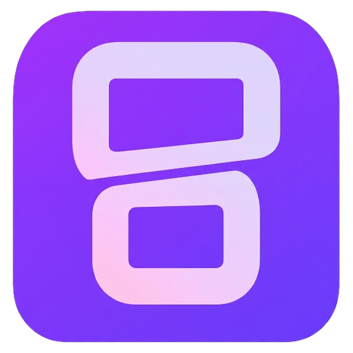

  

<h1 align="center">DualCPY Split</h1>

  <em>Mirror both screens of the AYN Thor (and other dual-screen handhelds) to your PC -
  built for streaming with OBS and for playing on your monitor with the handheld as a controller.</em>

> [!NOTE]
> DualCPY Split is a fork of **[DualCPY](https://github.com/theswest/DualCPY)** by the_swest.
> It keeps DualCPY's foundations (scrcpy docking, device profiles, file transfer) and adds an
> OBS-friendly stage, instant connecting, console aspect presets, audio fixes and much more -
> see the [changelog](CHANGELOG.md).

**Windows 11 recommended** (Windows 10 1809+ should work).

---

## Download

Grab **`DualCPY-Split-v1.0.1-windows.zip`** from the
[latest release](https://github.com/jakequi/DualCPY-Split/releases/latest), unzip it anywhere
and run **`DualCPY-Split.exe`**. scrcpy and adb are included - nothing else to install.
`config/` and `logs/` are created next to the exe on first launch.

### Run from source
1. Install Python 3.10-3.13 (tick *"Add python.exe to PATH"*).
2. `git clone https://github.com/jakequi/DualCPY-Split.git` and `cd DualCPY-Split`
3. `pip install -r requirements.txt`
4. `python main.py`

### Build the exe yourself
`pip install pyinstaller`, then `python build.py` - the app is in `dist/DualCPY-Split/`.

---

## First-time setup

On the handheld:
1. **Enable Developer options:** Settings > About device > tap *Build number* 7 times.
2. **USB:** turn on *USB debugging*, plug in, tap **Allow**. Done.
3. **Wi-Fi:** turn on *Wireless debugging* and tick **"Always allow on this network"**.
   In DualCPY Split choose *Pair / Connect Manually*, then on the handheld open
   *Wireless debugging > Pair device with pairing code* - DualCPY Split fills in the address,
   you just type the 6-digit code. You only pair once.
4. **Tip:** Developer options > *Quick settings developer tiles* > **Wireless debugging** puts a
   one-tap toggle in your quick settings.

From then on, just open DualCPY Split. It finds the handheld on USB or Wi-Fi by itself (even after
a restart, even though Android changes the port) and opens straight into the streams. If Wireless
debugging is off it waits and connects the moment you turn it on.

---

## Features

### For OBS / streaming
- **One window, exactly the game area** - no black bars for OBS to capture.
  **Both** stacks the screens, **Top** / **Bottom** show one screen. Switching keeps the height;
  dragging the edges keeps the shape.
- **Fullscreen** (F11) centres the game on a black backdrop that OBS doesn't see.
- **Split** turns the screens into two separate windows (resizable, individually capturable).
- **Controller overlay (experimental)** - the Thor's buttons and sticks drawn beside the bottom
  screen, lighting up live as you press them.
- **Aspect presets** by ratio with the consoles that use it ("4:3 (DS, NES, SNES, PS1, ...)",
  "3:2 (GBA)", "31:27 (Thor-B)", ...) - crops the black bars instantly, no stream restart.

### For playing on your monitor
- **Low-latency streaming** with Latency (Low / Balanced / Stable) and Quality
  (Standard / High / Very High / Max) presets.
- **Test Connection & Auto-Set** measures the Wi-Fi between handheld and PC and picks the best
  Latency and Quality for you.
- **Dim Thor screens** while you play on the monitor (restored afterwards).
- **Audio output** on the PC, the handheld, or both; per-stream **volume**.
- **Top / Bottom FPS** (up to 120, experimental) and an optional 30 FPS cap for the bottom screen.

### Everything else
- **Profiles** - save your whole setup; star one to load it on start-up.
- **Auto-reconnect** if a stream drops; nothing left running when you close (even after a crash).
- **File transfer**, **screenshots** (also in split mode), **device profiles** for other
  dual-screen handhelds (can be switched off).

### Hotkeys (work while gaming)
| Keys | Action |
|---|---|
| Ctrl+Alt+1 / 2 / 3 | View: Both / Top / Bottom |
| Ctrl+Alt+S | Cycle views |
| Ctrl+Alt+F, or F11 while DualCPY Split is in front | Fullscreen |
| Ctrl+Alt+M | Show / hide the control panel (also over fullscreen) |
| Ctrl+Alt+O | Dim / restore the Thor's screens |

### OBS setup
Add a **Window Capture** of the `DualCPY Split | <device>` window, then right-click it >
*Transform > Edit Transform* > **Bounding Box Type: Scale to inner bounds**, **Alignment: Center**.
Switching between Both / Top / Bottom is then seamless.

---

## Roadmap

Planned for future versions:
- **Fullscreen for split windows** - in Split mode, F11 makes the window you're in fullscreen on
  its own monitor over a true-black background (e.g. top screen on the TV, bottom on the laptop).
  Idea from [AndersonWood's DualCPY fork](https://github.com/AndersonWood/DualCPYerson).

Suggestions and bug reports: [issues](https://github.com/jakequi/DualCPY-Split/issues).

---

## Troubleshooting

- **Audio warps or crackles (Wi-Fi):** run *Test Connection & Auto-Set*, or set Latency to
  Balanced, then Stable. USB gives the cleanest audio.
- **Black or flickering screens:** Settings > Renderer > Direct3D 9.
- **Handheld not found:** check USB debugging / Wireless debugging is on and both devices are on
  the same network; *Pair / Connect Manually* in the waiting window lets you pair again.
- **Logs:** `logs/dualcpy_<date>.log` and per-stream `logs/scrcpy_*.log` next to the app.

---

## Bundled software & licences

- DualCPY Split is licensed under the **GNU GPL v3.0** - see [LICENSE](LICENSE). You are free to
  modify and redistribute it under the same terms.
- Includes **[scrcpy](https://github.com/Genymobile/scrcpy) v4.0** by Genymobile / Romain Vimont,
  unmodified, under the Apache License 2.0 ([bin/LICENSE_scrcpy.txt](bin/LICENSE_scrcpy.txt)).
- UI font **[Cal Sans](https://github.com/calcom/font)**, SIL Open Font License 1.1
  ([assets/fonts/OFL.txt](assets/fonts/OFL.txt)).

## Acknowledgements

- **[the_swest](https://github.com/theswest)** - creator of [DualCPY](https://github.com/theswest/DualCPY), which this fork is built on
  (support the original: https://ko-fi.com/theswest)
- **[tommywaaf](https://github.com/tommywaaf)** - performance work in DualCPY and
  [scrcpy-thor-ui](https://github.com/tommywaaf/scrcpy-thor-ui), source of the controller-overlay
  idea, the Direct3D 11 finding and the audio-buffer measurements
- **[DrSkyfaR](https://github.com/DrSkyfaR)** - file transfer and the Linux port of DualCPY
- **[AndersonWood](https://github.com/AndersonWood)** - split-window fullscreen idea (roadmap)
- **[eldermonkey](https://github.com/eldermonkey)** - the legacy logo
- **[scrcpy](https://github.com/Genymobile/scrcpy)** by Romain Vimont - the backend
- **[CustomTkinter](https://github.com/TomSchimansky/CustomTkinter)** - UI toolkit
